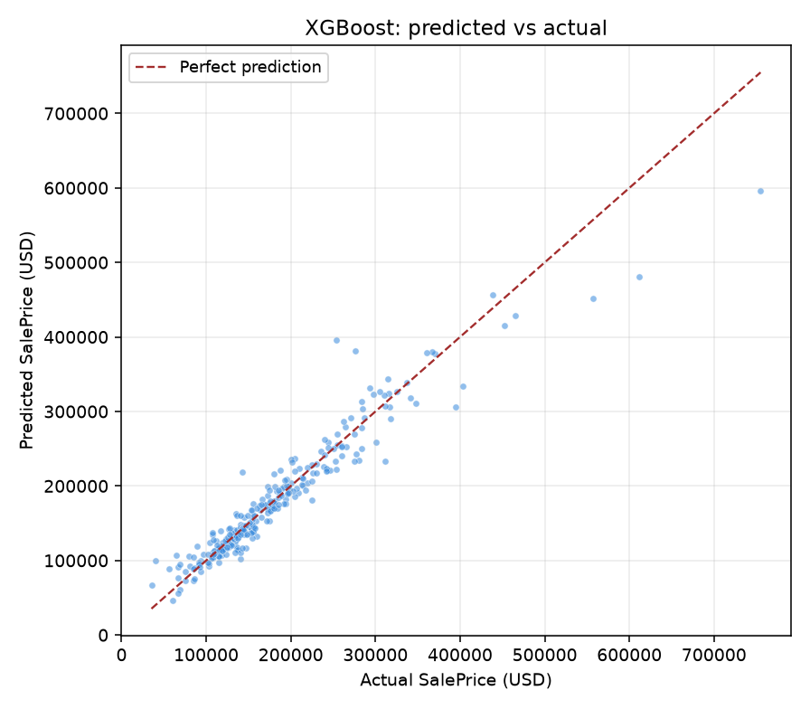

# HousePrice-AI

**端到端房价预估平台**：数据管道 → 多模型交叉验证选型 → 预测区间校准 → FastAPI 服务 → 可解释性分析 → 容器化部署。

[](https://github.com/Sojay0205/house-price-ai/actions/workflows/ci.yml)


---

## 核心结果

| 指标 | 数值 |
| --- | --- |
| 最终模型 | **XGBoost**（5 折 CV 从 5 个候选中选出） |
| 留出集 MAE | **$14,882**（房价中位数 $163,000，误差约 9.1%） |
| 留出集 R² | **0.9188** |
| 80% 预测区间实测覆盖率 | **80.5%**（名义 80%，平均宽度 $44,642） |
| 相较原 MLP 方案 | MAE 降低 **38%**（$24,144 → $14,882） |
| 测试 | 19 passed（预处理 / 注册表 / 接口契约三层） |



---

## 为什么不是"又一个波士顿房价预测"

这个项目的重点不在模型结构，而在**工程决策**。几个刻意的取舍：

**1. 换掉 Boston 数据集，改用 Ames Housing（1460 × 80）**
Boston 的 `B`（城镇黑人比例）特征带有种族指向性，scikit-learn 自 1.2 起已移除 `load_boston`；而且 506 条纯数值样本零缺失，展示不出任何数据清洗能力。Ames 含 23 个名义类别、23 个有序类别、大量缺失值，才是真实表格数据的形态。

**2. 用交叉验证而不是"跑一次看 MAE"**
5 个候选模型（Ridge / RandomForest / XGBoost / LightGBM / MLP）在同一预处理管道下做 5 折 CV，报 `mean ± std`。**MLP 的 CV RMSE 是 0.3192，比 Ridge 还差一倍**——原方案选深度学习是直觉，不是证据。这一点在 `reports/metrics.md` 里有完整对比。

**3. 预测区间用 conformal 校准，而不是直接输出分位数模型**
最初用 LightGBM 分位数损失模型出 P10/P90，实测覆盖率只有 **54%**——1460 条样本上分位数模型明显欠拟合，等于给用户一个"看起来很确定、其实不靠谱"的区间。改用 OOF 残差的 10%/90% 分位做加性校准后，覆盖率回到 **80.5%**。区间宽度由真实残差分布决定，而非拍脑袋的百分比。

**4. 预处理与模型打包成同一个 Pipeline 对象**
`ColumnTransformer`（中位数填补 + 标准化 / 常量填补 + 独热编码）与模型序列化在一起，推理端零手工复现，从根上消除 train/serve skew。

**5. 模型版本化 + 热切换**
`models/registry.json` 记录所有版本及其指标，`POST /models/{version}/activate` 切换后服务立即重载，不需要重启容器。

---

## 架构

```
┌──────────────────────────────────────────────────────────┐
│  演示层   Streamlit：表单 → 预测 → 区间 → SHAP 归因        │
└───────────────────────────┬──────────────────────────────┘
                            │ HTTP
┌───────────────────────────▼──────────────────────────────┐
│  API 层   FastAPI + Pydantic                              │
│  POST /predict  /predict/batch  /explain                  │
│  GET  /models   /health     POST /models/{v}/activate      │
└───────────────────────────┬──────────────────────────────┘
                            │ 常驻内存的 active 版本
┌───────────────────────────▼──────────────────────────────┐
│  模型层   sklearn Pipeline（预处理 + 模型）                │
│  registry.json：版本 / 指标 / 训练时间；conformal 区间参数  │
└───────────────────────────┬──────────────────────────────┘
                            │ 离线产出
┌───────────────────────────▼──────────────────────────────┐
│  训练流   数据校验 → 特征工程 → 5 折 CV 多模型对比 → 选优   │
│          → 残差校准区间 → 落盘 + 生成报告与诊断图          │
└──────────────────────────────────────────────────────────┘
```

---

## 模型对比

完整报告见 [`reports/metrics.md`](reports/metrics.md)。

**交叉验证（log 空间，越小越好）**

| 模型 | CV RMSE | ± std | CV R² | 训练耗时 |
| --- | ---: | ---: | ---: | ---: |
| **XGBoost** | **0.1240** | ±0.0156 | 0.8987 | 4.4s |
| LightGBM | 0.1294 | ±0.0141 | 0.8898 | 4.6s |
| Ridge | 0.1408 | ±0.0253 | 0.8682 | 6.5s |
| RandomForest | 0.1411 | ±0.0161 | 0.8688 | 11.5s |
| MLP (128-64-32-16) | 0.3192 | ±0.0672 | 0.3182 | 12.6s |

**留出集（美元口径，完全未参与选型）**

| 模型 | MAE | RMSE | R² | MAPE |
| --- | ---: | ---: | ---: | ---: |
| XGBoost | $14,882 | $24,956 | 0.9188 | 8.95% |
| Ridge | $15,737 | $24,422 | 0.9222 | 9.22% |
| LightGBM | $15,753 | $27,406 | 0.9021 | 9.21% |
| RandomForest | $17,206 | $29,791 | 0.8843 | 10.12% |
| MLP | $24,144 | $37,308 | 0.8185 | 14.53% |

> 结论：1460 条表格数据上，梯度提升树优于线性模型，也远优于多层感知机。选型依据是交叉验证均值，不是留出集——避免在测试集上反复挑模型。

---

## 快速开始

```bash
git clone https://github.com/Sojay0205/house-price-ai.git
cd house-price-ai

python -m venv .venv
.venv/Scripts/activate          # Windows
# source .venv/bin/activate     # macOS / Linux
pip install -e ".[dev]"

make data     # 拉取 Ames Housing（首次联网，之后离线可用）
make train    # 训练 5 个模型 + 校准区间 + 生成报告与图表
make serve    # http://127.0.0.1:8000/docs
make app      # http://127.0.0.1:8501 （另开一个终端）
```

容器方式（需先执行 `make train` 产出模型）：

```bash
docker compose up --build
# API:  http://localhost:8000/docs
# Demo: http://localhost:8501
```

---

## API 示例

```bash
curl -X POST http://127.0.0.1:8000/predict \
  -H "Content-Type: application/json" \
  -d '{"features":{"OverallQual":8,"GrLivArea":2000,"YearBuilt":2005,
       "Neighborhood":"NridgHt","TotalBsmtSF":1200,"FullBath":2,"GarageCars":3}}'
```

```json
{
  "prediction": 225947.21,
  "interval": {"low": 199887.56, "high": 256861.92, "confidence": 0.8},
  "currency": "USD",
  "model_version": "v1",
  "algorithm": "XGBoost"
}
```

设计细节：**只传关心的字段即可**。Ames 有 80 个属性，强迫调用方每次传全量不现实——缺失字段由训练集的中位数/众数兜底（`defaults` 随模型一起保存）。未知字段名直接返回 422，避免拼写错误被静默忽略。

| 接口 | 说明 |
| --- | --- |
| `POST /predict` | 单条预测，返回点估计 + 80% 区间 |
| `POST /predict/batch` | 批量预测（≤1000 条） |
| `POST /explain` | SHAP 归因，返回贡献度 Top-K |
| `GET /models` | 版本列表 + 当前 active |
| `POST /models/{version}/activate` | 热切换线上版本 |
| `GET /health` | 健康检查（供容器探针使用） |

---

## 项目结构

```
house-price-ai/
├── src/houseprice/
│   ├── config.py              # 路径、种子、切分参数集中管理
│   ├── data/
│   │   ├── loader.py          # 拉取 + 缓存 + 缺失率过滤 + 兜底值
│   │   └── preprocess.py      # ColumnTransformer → Pipeline
│   ├── features/build.py      # 9 个派生特征 + 单样本组装
│   ├── models/
│   │   ├── train.py           # CV 对比 → 选优 → 落盘 → 出报告
│   │   ├── interval.py        # conformal 残差校准
│   │   ├── evaluate.py        # 指标与诊断图
│   │   └── registry.py        # 版本注册表
│   ├── explain/shap_explainer.py
│   └── api/{main,schemas}.py
├── app/streamlit_app.py       # 演示前端
├── tests/                     # 19 个测试，全程离线
├── reports/metrics.md         # 由训练脚本生成
├── docs/figures/              # 诊断图与 SHAP 图
├── Dockerfile / docker-compose.yml
├── Makefile
└── .github/workflows/ci.yml   # push 自动 lint + test
```

---

## 可复现性

- 全局随机种子 `42`（数据切分、KFold、XGBoost / LightGBM / RF / MLP 全部固定）
- 数据首次拉取后缓存为 `data/raw/ames.csv`，之后训练完全离线
- `make train` 一条命令重建 `reports/metrics.md` 与全部图表，无手工步骤

## 已知限制

- 1460 条样本、单城市（Ames, Iowa）数据，跨城市泛化不可信
- 类别特征全部走独热编码，高基数特征（`Neighborhood` 25 类）尚可，但规模更大时应换 target encoding
- 未做数据漂移监控（PSI）与定时重训，属于后续 Roadmap
- 单机单进程部署，未压测并发

## Roadmap

- [ ] 特征分布漂移监控（PSI）+ 阈值告警
- [ ] MLflow 实验追踪（替换自建 registry）
- [ ] Optuna 超参搜索
- [ ] 高基数类别特征的 target encoding 对照实验

---

## License

MIT
